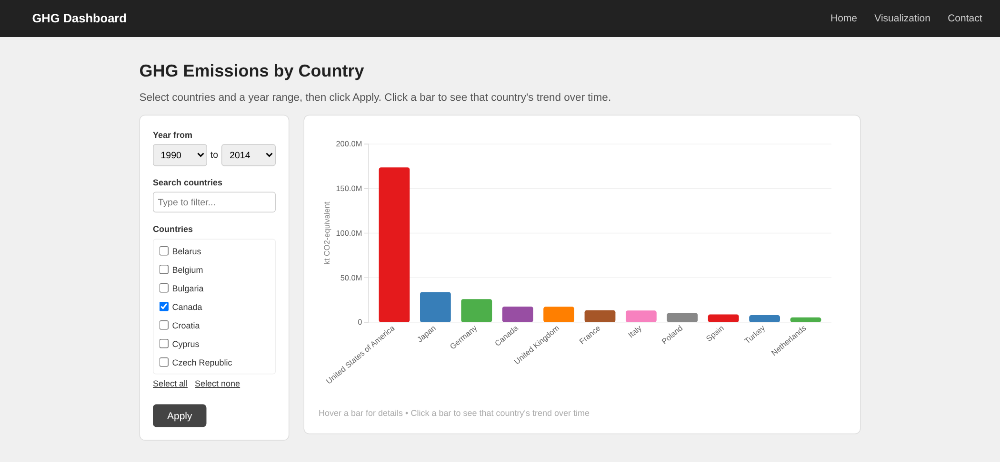
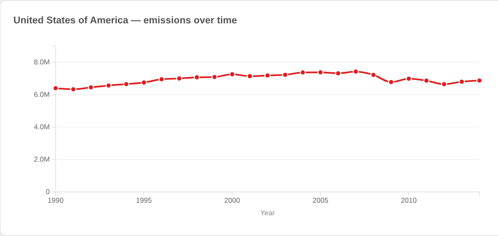

# Greenhouse Gas Emissions Dashboard

An interactive web dashboard for exploring country-level greenhouse gas emissions from 1990 to 2014. Pick countries and a year range, compare their totals, then click a country to see how its emissions changed over time.

Built for the Data Visualisation course in the Applied Data Science & AI program at Zuyd University of Applied Sciences.





## Features

- Sorted bar chart of total emissions per country, drawn with D3.js, with tooltips on hover
- Click any bar to open a line chart of that country's yearly trend
- Filter by any combination of 43 countries (with a search box) and a start and end year
- Flask backend with a JSON endpoint (`/api/data`) that does the filtering
- Total GHG emissions (excluding land use, in kilotonnes CO2 equivalent) from the UN greenhouse gas inventory

## Tech stack

Python, Flask, D3.js, JavaScript, HTML, CSS

## How to run

```bash
pip install -r requirements.txt
python app.py
```

Then open http://127.0.0.1:5000 in your browser.

## Project structure

```
app.py                  Flask app and /api/data endpoint
templates/              page templates (home, visualisation, contact)
static/js/viz.js        D3.js bar chart, line chart and filters
static/css/style.css    styling
static/data/            UN greenhouse gas data (CSV)
docs/                   screenshots
```

## Data

`static/data/ghg_data.csv` holds the UN greenhouse gas inventory data. The dashboard uses the total GHG emissions series (excluding land use, land-use change and forestry) for 43 countries from 1990 to 2014.
